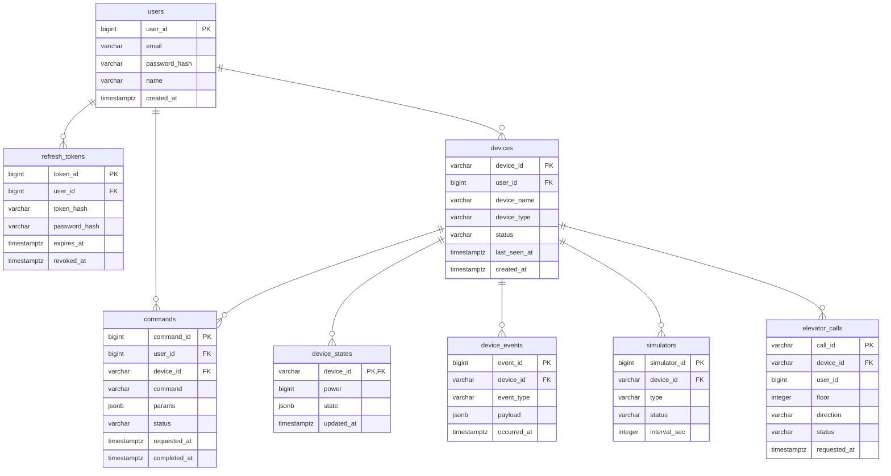

# ERD

[← README](../../README.md)

- 서비스마다 자기 DB를 가집니다. 다른 서비스의 DB는 직접 읽지 않고 API를 호출합니다
- 전체 그림: [Home_IoT_ERD.svg](Home_IoT_ERD.svg)

## 전체 테이블

## DB 테이블 변경 · 시드 데이터
| 항목 | 방법 |
|---|---|
| 테이블 구조 | [`db/schema.sql`](../../db/schema.sql) (2026-11-27 실제 DB에서 뽑음). 구조를 바꾸면 이 파일도 같은 PR에서 고침 |
| 시드 데이터 | [`db/seed.sql`](../../db/seed.sql), 실행 방법: [DB 구조 · 샘플 데이터](../db-seed.md) |

> 위 그림의 일부 컬럼은 실제 DB와 다릅니다 (예: `devices.name` · `type`, `commands.command_id` 는 문자열, `device_states.power` 는 `on`/`off`). 실제 구조는 `db/schema.sql` 을 기준으로 봅니다.