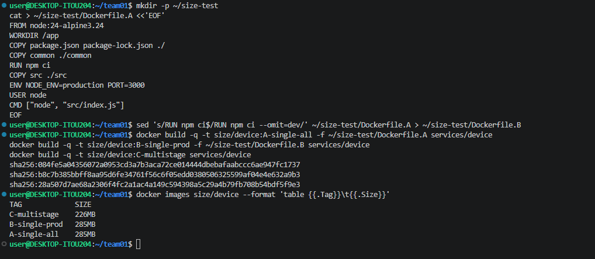

# 이미지 크기 전후 비교 (멀티스테이지 빌드)

[← README](../README.md) · [이미지 태그 규칙](deploy-tags.md)

## 1. 결과

같은 device 코드를 세 가지 Dockerfile로 빌드해서 비교했습니다 (2026-11-25, `docker images` 기준).

| 방식 | Dockerfile | 크기 | 차이 |
| --- | --- | --- | --- |
| A. 한 단계 + 패키지 전부 (개선 전) | `node:24-alpine3.24` 하나로 `npm ci` | 285MB | 기준 |
| B. 한 단계 + 개발용 패키지 제외 | A에서 `npm ci --omit=dev` | 285MB | 0 |
| **C. 멀티스테이지 (현재)** | `services/device/Dockerfile` | **226MB** | **-59MB (약 21%)** |



## 2. 왜 이렇게 나왔나

- **A와 B가 같은 이유**: device에는 개발용 패키지(devDependencies)가 없습니다. 테스트를 Node.js 내장 `node --test`로 하기 때문입니다.
- **C가 작은 이유**: 1단계에서 패키지를 설치하고, 2단계(`alpine:3.24`)에는 **node 실행 파일 + 코드 + 필요한 패키지만** 복사합니다. npm, yarn, corepack 같은 설치 도구는 실행 이미지에 들어가지 않습니다.

## 3. 보안 효과

- 실행 이미지에 npm 같은 도구가 없어 공격에 쓰일 수 있는 프로그램이 줄어듭니다.
- 이미지에 든 패키지가 적어 Trivy 검사 대상도 줄어듭니다 (CI에서 CRITICAL이 있으면 배포를 멈춤).
- `USER node`로 관리자(root)가 아닌 사용자로 실행합니다.

## 4. 적용 현황

| 이미지 | 방식 |
| --- | --- |
| auth, control, device, simulator, telemetry | 멀티스테이지 (node 설치 → alpine에 결과만) |
| web | 멀티스테이지 3단계 (의존성 → 빌드 → 실행) |
| sample | 한 단계 (연습용) |
| web-nginx | `nginx:1.30.7-alpine` 한 단계 (빌드할 코드 없음) |

## 5. 다시 재 보는 방법

```bash
mkdir -p ~/size-test
cat > ~/size-test/Dockerfile.A <<'EOF'
FROM node:24-alpine3.24
WORKDIR /app
COPY package.json package-lock.json ./
COPY common ./common
RUN npm ci
COPY src ./src
ENV NODE_ENV=production PORT=3000
USER node
CMD ["node", "src/index.js"]
EOF
sed 's/RUN npm ci$/RUN npm ci --omit=dev/' ~/size-test/Dockerfile.A > ~/size-test/Dockerfile.B

docker build -q -t size/device:A-single-all  -f ~/size-test/Dockerfile.A services/device
docker build -q -t size/device:B-single-prod -f ~/size-test/Dockerfile.B services/device
docker build -q -t size/device:C-multistage  services/device
docker images size/device --format 'table {{.Tag}}\t{{.Size}}'
```
