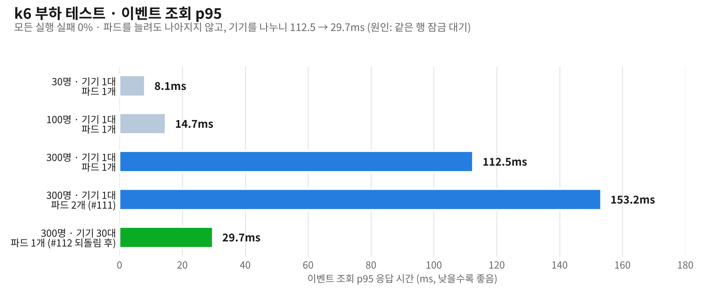
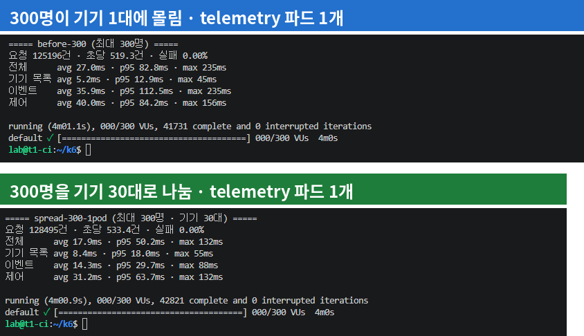
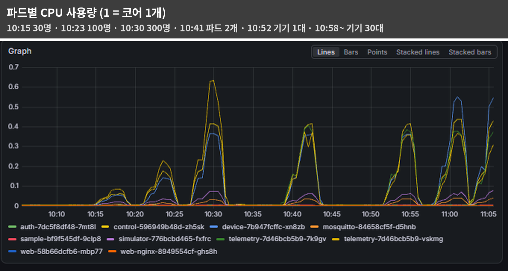
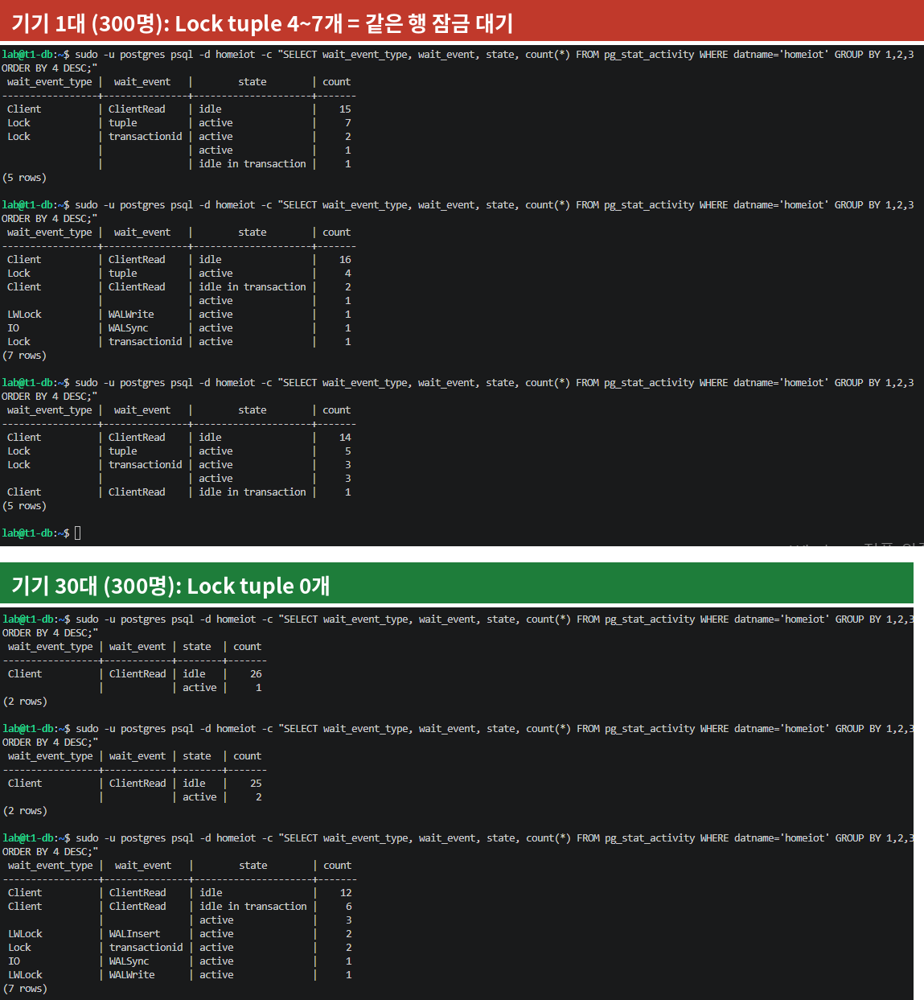

# 부하 테스트 (k6)

[← README](../README.md) · [관측 설계](observability.md) · [지표 가이드](metrics-guide.md) · [롤백 시연](rollback-demo.md)

2026-11-27, dev 클러스터에 k6로 부하를 주고 병목을 찾았습니다. 스크립트: [`load/home-iot.js`](../load/home-iot.js)



## 1. 한눈에

- **동시 100명(목표)까지 문제없음**: 실패 0%, 모든 API p95 100ms 이하
- **300명에서 이벤트 조회만 느려짐** (p95 14.7ms → 112.5ms)
- CPU가 원인이라 보고 telemetry 파드를 2개로 늘렸지만(#111) **오히려 153.2ms** → 되돌림(#112)
- DB를 보니 원인은 **모든 가상 사용자가 같은 기기 1대를 조작해서 생긴 행 잠금 대기**. 기기를 30대로 나누면 같은 300명에서 **29.7ms**
- 실제 서비스는 집마다 기기가 따로라 이 잠금은 거의 생기지 않음. 다만 한 기기에 명령이 몰리면 느려질 수 있다는 한계를 확인함

## 2. 시나리오

사용자가 앱을 쓰는 흐름을 여러 명이 동시에 반복합니다. 한 번 돌 때 3개 API를 부르고 1초 쉽니다.

| 순서 | API | 지나가는 서비스 |
|---|---|---|
| 1 | `GET /api/v1/devices` 기기 목록 | Gateway(JWT) → device → DB |
| 2 | `GET /api/v1/devices/{id}/events?limit=20` 이벤트 | Gateway → telemetry → device(소유 확인) → DB |
| 3 | `POST /api/v1/devices/{id}/commands` 밝기 바꾸기 | Gateway → control → device → MQTT → simulator → MQTT → control · telemetry → DB |

- 사용자 수: 30초 동안 ⅓까지 → 1분 유지 → 30초 동안 최대까지 → 1분 30초 유지 → 30초 동안 0 (총 4분)
- 통과 기준(thresholds): 실패 1% 미만, 목록 · 이벤트 p95 500ms 미만, 제어 p95 1초 미만 (제어는 기기 응답을 기다리는 API)
- 전용 계정 `k6@visionus.test` 와 전용 기기 `k6-light-01 ~ N` 을 씁니다. prod 주소를 넣으면 시작 전에 멈춥니다
- 부하는 t1-ci에서 dev Gateway(`10.10.21.100`)로 보냈습니다

## 3. 결과

모든 실행에서 **실패 0%**. 시간은 p95(요청 100개 중 느린 5번째).

| 실행 | 동시 사용자 | 기기 | telemetry 파드 | 초당 요청 | 전체 | 기기 목록 | **이벤트** | 제어 |
|---|---|---|---|---|---|---|---|---|
| before-30 | 30 | 1대 | 1 | 53 | 52.8ms | 3.6ms | **8.1ms** | 82.0ms |
| before-100 | 100 | 1대 | 1 | 179 | 62.2ms | 5.7ms | **14.7ms** | 84.7ms |
| before-300 | 300 | 1대 | 1 | 519 | 82.8ms | 12.9ms | **112.5ms** | 84.2ms |
| after-300 (#111) | 300 | 1대 | 2 | 517 | 94.7ms | 12.8ms | **153.2ms** | 79.0ms |
| hot-300 (DB 확인용) | 300 | 1대 | 2 | 522 | 81.8ms | 12.2ms | **130.2ms** | 75.9ms |
| spread-300 | 300 | 30대 | 2 | 531 | 50.8ms | 22.1ms | **29.1ms** | 65.5ms |
| spread-300b (재현) | 300 | 30대 | 2 | 533 | 50.3ms | 20.5ms | **27.2ms** | 65.6ms |
| spread-300-1pod (#112 후) | 300 | 30대 | 1 | 533 | 50.2ms | 18.0ms | **29.7ms** | 63.7ms |

- 제어가 다른 API보다 느린 것은 정상입니다. 명령을 MQTT로 보내고 시뮬레이터의 결과를 기다렸다가 응답합니다
- 기기 30대일 때 기기 목록이 조금 느려진 것은 목록에 나오는 기기가 1대 → 30대로 늘었기 때문입니다



## 4. 병목을 찾은 과정

### ① 가설: telemetry CPU 부족 → 틀림

300명에서 telemetry CPU가 약 0.63코어(그래프 눈대중)로 가장 높았습니다. Node.js는 파드 하나가 코어 1개 근처에서 막히므로 파드를 2개로 늘렸습니다(#111, dev만).

- telemetry는 MQTT를 공유 구독(`$share/telemetry/...`)으로 받아서, 파드를 늘려도 메시지가 두 파드에 나뉘고 이벤트가 두 번 기록되지 않습니다
- 결과: CPU는 두 파드에 각각 약 0.4코어로 나뉘었지만, 이벤트 조회 p95는 112.5ms → **153.2ms** 로 오히려 나빠졌습니다 → **CPU가 원인이 아님**



### ② 가설: 이벤트 조회 쿼리에 인덱스 없음 → 틀림

테스트마다 이벤트가 수만 건씩 쌓여(테스트 후 k6 기기 이벤트 약 20만 건) 조회가 느려졌을 수 있다고 봤습니다.

```bash
# t1-db
sudo -u postgres psql -d homeiot -c '\d dev.device_events'
sudo -u postgres psql -d homeiot -c "EXPLAIN ANALYZE SELECT event_id, event_type, payload, occurred_at FROM dev.device_events WHERE device_id='k6-light-01' ORDER BY occurred_at DESC LIMIT 20;"
```

- 인덱스 `idx_device_events_device_time (device_id, occurred_at DESC)` 가 이미 있고, `Index Scan` 으로 **0.1ms** 에 끝났습니다 → **쿼리 자체는 빠름**

### ③ 원인: 같은 기기 1대의 행 잠금 대기 → 맞음

telemetry는 기기 상태를 저장할 때 그 기기 행을 잠급니다 (`SELECT ... FOR UPDATE`, `services/telemetry/src/index.js` 의 `handleState`). 같은 기기의 상태가 동시에 바뀌어 꼬이지 않게 하는 정상 동작입니다.

그런데 테스트에서는 **300명 모두 `k6-light-01` 한 대에 명령**을 보냈습니다.

1. 상태 저장이 같은 행 하나를 두고 한 줄로 서서 처리됨
2. 기다리는 동안 DB 연결(파드당 최대 5개, `DB_POOL_MAX`)을 붙잡고 있음
3. 이벤트 조회도 쓸 연결을 기다린 것으로 봄 → p95 상승 (잠금 대기는 DB에서 확인, 연결 대기는 정황으로 추론)
4. 파드를 2개로 늘리면 같은 행을 노리는 대기자만 늘어나 더 느려짐 (①의 결과와 맞음)

테스트 중 DB에서 지금 무엇을 기다리는지 봤습니다 (300명 구간에서 몇 초 간격으로 3번):

```bash
sudo -u postgres psql -d homeiot -c "SELECT wait_event_type, wait_event, state, count(*) FROM pg_stat_activity WHERE datname='homeiot' GROUP BY 1,2,3 ORDER BY 4 DESC;"
```

| | 기기 1대 | 기기 30대 |
|---|---|---|
| `Lock tuple` (같은 행 잠금 대기) | **4 ~ 7개** | **0개** |
| `Lock transactionid` (앞 트랜잭션 끝나길 대기) | 1 ~ 3개 | 0 ~ 2개 |
| 일하는(`active`) 연결 | 대부분 잠금 대기 (나머지 약 15개는 `idle`) | 1 ~ 3개, 잠금 대기 거의 없음 (대부분 `idle`) |



### ④ 확인: 기기를 나누면 정상

스크립트에 `DEVICES` 옵션을 넣어 사용자들을 기기 30대에 나눠 붙였습니다 (실제로 집마다 기기가 따로인 상황). 파드를 1개로 되돌린 뒤(#112) 같은 300명으로 돌리니 이벤트 조회 p95가 **112.5ms → 29.7ms** 였습니다. 파드 2개일 때(27.2 ~ 29.1ms)와 차이가 없어, 파드 수가 아니라 기기 분산이 차이를 만든 것을 확인했습니다.

## 5. 배운 것 · 개선할 점

| 배운 것 | 설명 |
|---|---|
| 추측하지 말고 측정 | CPU가 가장 높은 서비스가 병목이라고 단정했지만 틀렸음. DB 대기 상태(`pg_stat_activity`)를 보고서야 원인을 찾음 |
| 파드 늘리기가 답이 아닐 때가 있음 | 같은 자원(행 · 락)을 두고 경쟁하면 파드를 늘릴수록 대기자만 늘어남 |
| 테스트 데이터도 현실적이어야 함 | 기기 1대에 300명이 몰리는 일은 실제로 거의 없음. 시나리오가 결과를 좌우함 |
| GitOps로 실험하고 되돌리기 | 파드 수 변경 · 되돌림을 PR(#111 · #112)로 해서 무엇을 언제 바꿨는지 대시보드 배포 표시와 Git에 남음 |

개선할 점 (지금은 하지 않음)

- 한 기기에 명령이 몰리는 경우(예: 여러 가족이 같은 조명을 동시에 조작)를 대비하려면 telemetry의 상태 저장에서 잠금을 잡는 시간을 줄이거나, 이벤트 조회용 DB 연결을 따로 두는 방법이 있음
- `kubectl top` 은 metrics-server가 없어 안 됨 → CPU는 Grafana Explore에서 `sum by (pod) (rate(container_cpu_usage_seconds_total{namespace="home-iot", container!=""}[1m]))` 로 봄
- 더 큰 부하(10배 등)와 HPA(자동 파드 늘리기)는 심화 과제

## 6. 다시 해보기

```bash
# t1-ci (k6 설치: 홈 폴더에만, sudo 필요 없음)
mkdir -p ~/k6/results && cd ~/k6
curl -sL https://github.com/grafana/k6/releases/download/v0.54.0/k6-v0.54.0-linux-amd64.tar.gz | tar xz
cp <저장소>/load/*.js .

read -s K6_PASSWORD; export K6_PASSWORD      # 테스트 계정 비밀번호. Git에 쓰지 않음
LABEL=before-100 PEAK=100 ./k6-v0.54.0-linux-amd64/k6 run home-iot.js              # 기기 1대
LABEL=spread-300 PEAK=300 DEVICES=30 ./k6-v0.54.0-linux-amd64/k6 run home-iot.js   # 기기 30대
DEVICES=30 ./k6-v0.54.0-linux-amd64/k6 run cleanup.js                              # 뒷정리: 테스트 기기 삭제
unset K6_PASSWORD
```

- 결과는 화면 마지막 6줄과 `results/<LABEL>.json` 에 남습니다
- 돌리기 전에 팀 채널에 알립니다 (dev가 잠깐 느려지거나 dev 경보가 올 수 있음)
- 테스트 기기를 지우면 그 기기의 이벤트 · 상태도 함께 지워집니다
