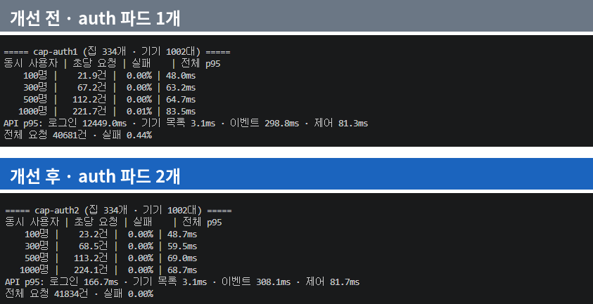

# 부하 테스트 (k6 · 출시 전 용량 테스트)

[← README](../README.md) · [관측 설계](observability.md) · [런북](runbook.md) · [롤백 시연](rollback-demo.md)

2026-11-27, dev 클러스터에서 "예상보다 훨씬 많은 사용자가 각자 기기를 등록해 두고 동시에 쓰면 버티는가"를 k6로 확인했습니다. 스크립트: [`load/capacity.js`](../load/capacity.js)


## 1. 한눈에

- **이미 접속한 사용자는 1,000명(예상의 10배)까지 문제없음**: 단계마다 p95 84ms 이하, 기획서 기준(p95 0.5초) 통과
- **사용자가 한꺼번에 새로 들어오는 순간이 약점**: 30초에 약 500명이 로그인하면(초당 약 17명) 인증(auth) 서비스가 막혀 로그인 p95 12.4초, 실패 0.44%, auth 파드 재시작
- **조치**: auth 파드를 2개로 → 로그인 p95 0.17초, 실패 0%, 재시작 없음
- **남은 개선점**: HPA로 몰릴 때만 자동으로 늘리기(심화 과제), 종료 순서, 살아 있는지 검사 대기 시간

## 2. 테스트 설계

| 항목 | 조건 |
|---|---|
| 규모 | 예상 동시 접속 100명(가정, 기획서에는 사용자 수 목표 없음) → 10배인 1,000명까지. 100 → 300 → 500 → 1,000명, 단계마다 1분 유지, 단계 사이 30초에 걸쳐 늘림 (총 6분 30초) |
| 집 · 기기 | 집(계정) 334개 `k6-u001 ~ k6-u334@visionus.test`, 집마다 기기 3대(조명 · 에어컨 · 공기청정기) = 1,002대. 한 집에 1~3명 |
| 사용자 행동 | 앱을 켜면 로그인 → 반복: 기기 목록(항상) → 이벤트 보기(50%) → 켜기/끄기(20%) → 화면 보며 5~10초 |
| 통과 기준 | 기획서 NFR: API 응답 p95 0.5초 안, 제어 1초 안 / 팀 기준: 실패 1% 미만 |
| 안전장치 | 실패율 5% 넘으면 자동 중단 (dev · prod가 DB 서버 t1-db를 같이 씀). prod에는 돌리지 않음 |
| 부하 보낸 곳 | t1-ci → dev Gateway `10.10.21.100` |

- 테스트용 계정 · 기기는 시작할 때 만들고(단계별 · API별 숫자에서는 빠지고 전체 요청 수에만 포함), 끝나면 [`load/capacity-cleanup.js`](../load/capacity-cleanup.js)로 기기를 지웁니다
- 단계별 숫자는 사용자 수를 **유지한 1분**만 잰 것이고, 로그인 · 실패 (전체)는 사용자가 늘어나는 구간까지 포함합니다

## 3. 결과

| | auth 파드 1개 (개선 전) | auth 파드 2개 (개선 후) |
|---|---|---|
| 100명 유지 | 초당 21.9건 · p95 48.0ms · 실패 0% | 초당 23.2건 · p95 48.7ms · 실패 0% |
| 300명 유지 | 초당 67.2건 · p95 63.2ms · 실패 0% | 초당 68.5건 · p95 59.5ms · 실패 0% |
| 500명 유지 | 초당 112.2건 · p95 64.7ms · 실패 0% | 초당 113.2건 · p95 69.0ms · 실패 0% |
| 1,000명 유지 | 초당 221.7건 · p95 83.5ms · 실패 0.01% | 초당 224.1건 · p95 68.7ms · 실패 0% |
| **로그인 p95 (전체)** | **12.4초** | **0.17초** |
| **실패 (전체)** | **0.44%** | **0%** |
| auth 재시작 | 테스트마다 1번 (3번 돌려 3번) | 없음 |
| API p95 (전체) | 목록 3.1ms · 이벤트 298.8ms · 제어 81.3ms | 목록 3.1ms · 이벤트 308.1ms · 제어 81.7ms |



## 4. 원인과 조치 (트러블슈팅)

### 증상

auth 파드 1개일 때 사용자가 500명 → 1,000명으로 늘어나는 30초(약 500명이 새로 로그인, 초당 약 17명)에 로그인 p95 12.4초, 일부 요청 실패, auth 파드 재시작. 이미 로그인한 사용자의 요청은 정상.

### 어디가 바쁜가

Grafana Explore에서 파드별 CPU를 봤습니다 (`kubectl top` 은 metrics-server가 없어 안 됨).

```promql
sum by (pod) (rate(container_cpu_usage_seconds_total{namespace="home-iot", container!=""}[1m]))
```

로그인이 몰릴 때 **auth만** 0.7~0.9코어까지 치솟았습니다 (그림은 오후 2시 개선 전 · 후 테스트, 1분 평균). Node.js는 파드 하나가 코어 1개 근처가 한계입니다.


### 왜

```bash
# t1-dev-cp
kubectl -n home-iot get events --field-selector involvedObject.name=<auth 파드> --sort-by=.lastTimestamp
kubectl -n home-iot logs <auth 파드> --previous --tail=15
```

1. 비밀번호 확인에 쓰는 `bcryptjs` 는 순수 자바스크립트라, 확인 계산이 CPU를 독차지해 다른 요청이 오래 줄을 섬 (로그에 4.4초 걸린 로그인이 결국 500으로 끝난 기록)
2. 살아 있는지 검사(`/healthz`, 기본 대기 1초)에도 대답을 못 해 3번 연속 실패 → `Container auth failed liveness probe, will be restarted`
3. 꺼지는 과정에서 처리 중인 요청이 끝나기 전에 DB 연결을 닫아, 그 로그인들이 500 → `Cannot use a pool after calling end on the pool`
4. 새로 뜨는 동안 잠깐 요청을 못 받음 → `Readiness probe failed: connection refused`

### 조치

dev overlay에서 auth 파드를 2개로 늘렸습니다 (PR 한 줄, prod는 그대로). auth는 상태를 파드에 두지 않아(서명 키는 Secret, refresh 토큰은 DB) 늘려도 안전합니다. 같은 조건으로 다시 재니 로그인 p95 12.4초 → 0.17초, 실패 0.44% → 0%, 재시작 없음.

### 남은 개선점

| 개선점 | 설명 |
|---|---|
| HPA (심화 과제) | 지금은 손으로 2개 고정. CPU를 보고 몰릴 때만 늘렸다 줄이게 자동화. metrics-server 설치가 먼저 |
| 종료 순서 | 꺼질 때 처리 중인 요청이 끝난 뒤 DB 연결을 닫아야 함 (`common/src/service.js`, 모든 서비스 공통) |
| 살아 있는지 검사 | 대기 1초 · 3번이면 바쁜 파드도 죽은 것으로 봄. `timeoutSeconds` · `failureThreshold` 조정 검토 |
| 이벤트 조회 | 기준 안(p95 약 0.3초)이지만 다른 API보다 느림. 원인은 아직 확인하지 않음 |

## 5. 다시 해보기

```bash
# t1-ci (k6 설치: 홈 폴더에만, sudo 필요 없음)
mkdir -p ~/k6/results && cd ~/k6
curl -sL https://github.com/grafana/k6/releases/download/v0.54.0/k6-v0.54.0-linux-amd64.tar.gz | tar xz
cp <저장소>/load/*.js .

read -s K6_PASSWORD; export K6_PASSWORD      # 테스트 계정 비밀번호. Git에 쓰지 않음
LABEL=capacity ACCOUNTS=334 STEPS=100,300,500,1000 ./k6-v0.54.0-linux-amd64/k6 run capacity.js
ACCOUNTS=334 ./k6-v0.54.0-linux-amd64/k6 run capacity-cleanup.js   # 뒷정리: 테스트 기기 삭제
unset K6_PASSWORD
```

- 결과는 화면 마지막 표와 `results/<LABEL>.json` 에 남습니다
- 돌리는 동안 prod Grafana를 같이 보고, prod가 느려지면 Ctrl+C로 멈춥니다
