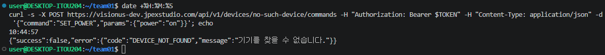
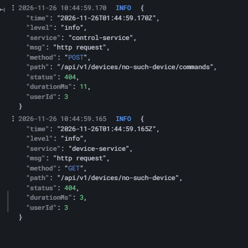

# 에러 로그로 원인 찾은 사례

[← README](../README.md) · [관측 설계](observability.md) · [모니터링 가이드](monitoring-guide.md) · [런북](runbook.md)

> KT Cloud 프로젝트 가이드 P2 기본 3 「로그 파이프라인」 결과물: **에러 로그로 원인 찾은 사례 1건**

## 로그 파이프라인 구성

```
서비스 파드 (JSON 한 줄 로그, stdout)
   └─ Alloy (파드 1개, 쿠버네티스 API로 모든 파드 로그를 읽음, 라벨: namespace · app · pod · container)
        └─ Loki (저장, ns monitoring)
             └─ Grafana Explore (LogQL로 검색)
```

- Node.js 서비스 5개(auth · device · control · telemetry · simulator)는 공통 로거로 요청마다 `http request` 로그를 남깁니다: `service`, `method`, `path`, `status`, `durationMs`, `userId`
- 그래서 `| json` 한 번으로 필드를 꺼내 `status >= 400` 처럼 조건 검색이 됩니다

## 사례 1. "기기 제어가 안 돼요" — Loki로 서비스 간 원인 추적 (2026-11-26, dev)

### 증상

사용자가 기기 제어 API를 호출했는데 실패 응답을 받음.

```
POST /api/v1/devices/no-such-device/commands   (10:44:57)
→ {"success":false,"error":{"code":"DEVICE_NOT_FOUND","message":"기기를 찾을 수 없습니다."}}
```



제어는 control 서비스가 받지만, 기기 정보는 device 서비스가 갖고 있어서 **어느 서비스에서 실패했는지** 응답만으로는 알 수 없음.

### 로그 검색 (Grafana → Explore → Loki)

control과 device 로그를 한 번에, 에러(400 이상)만 검색:

```logql
{namespace="home-iot", app=~"control|device"} | json | status >= 400
```



| 시각 | 서비스 | 요청 | status | 걸린 시간 |
|---|---|---|---|---|
| 10:44:59.165 | device-service | `GET /api/v1/devices/no-such-device` | 404 | 3ms |
| 10:44:59.170 | control-service | `POST /api/v1/devices/no-such-device/commands` | 404 | 11ms |

### 원인

1. control이 명령을 보내기 전에 device 서비스에 **기기 조회**를 먼저 함
2. device가 `no-such-device` 를 찾지 못해 **404** (5ms 먼저 찍힘)
3. control은 device가 준 에러(404, `DEVICE_NOT_FOUND`)를 그대로 사용자에게 전달 (`common/src/http-client.js`)
4. 같은 `userId`(3)와 같은 기기 ID가 두 로그에 찍혀 있어 **같은 요청의 흐름**임을 확인

→ 결론: control·MQTT·시뮬레이터 문제가 아니라 **등록되지 않은 기기 ID로 요청**한 것. 서버 장애 아님(응답 시간도 정상), 사용자 입력 문제.

### 대응

- 사용자: 기기 목록(`GET /api/v1/devices`)에서 올바른 ID 확인 후 다시 요청
- 운영: 404가 갑자기 많아지면 웹 화면이 잘못된 ID를 보내는지(배포 직후라면 web 버전) 확인

### 이번에 알게 된 개선점

| 문제 | 개선 |
|---|---|
| 로그에 `status`(404)만 있고 에러 코드(`DEVICE_NOT_FOUND`)는 없음 | 에러 응답 시 `code` 도 로그에 남기기 |
| 두 로그를 시각 · userId · 경로로 짝지음 (요청이 많으면 헷갈림) | `x-request-id` 를 Gateway에서 만들어 서비스 사이에 전달하고 로그에 남기기 ([관측 설계 5절](observability.md) 체크리스트 항목) |

## 사례 2. CI에서 sample 빌드 실패 — Jenkins 로그로 원인 찾기 (2026-11-19)

로그 파이프라인(Loki) 밖의 사례지만, 실제로 겪은 장애라 같이 남깁니다.

| 단계 | 내용 |
|---|---|
| 증상 | 디스코드 #배포-알림에 sample 빌드 ❌ (빌드 #23) |
| 로그 | Jenkins 콘솔: Trivy 이미지 검사 단계에서 `SIGBUS` 로 비정상 종료 (exit 2) |
| 원인 | 여러 서비스 빌드가 **동시에** 같은 Trivy 캐시(`/var/lib/jenkins/.trivy`)의 취약점 DB를 갱신하다 파일이 깨짐 |
| 임시 조치 | sample 재빌드 → 성공 |
| 해결 | Jenkinsfile에서 빌드(Job)마다 캐시 폴더 분리: `--cache-dir "$JENKINS_HOME/.trivy-$JOB_NAME"` |
| 결과 | 지금 모든 서비스 Jenkinsfile이 Job별 캐시 폴더를 씀 |
