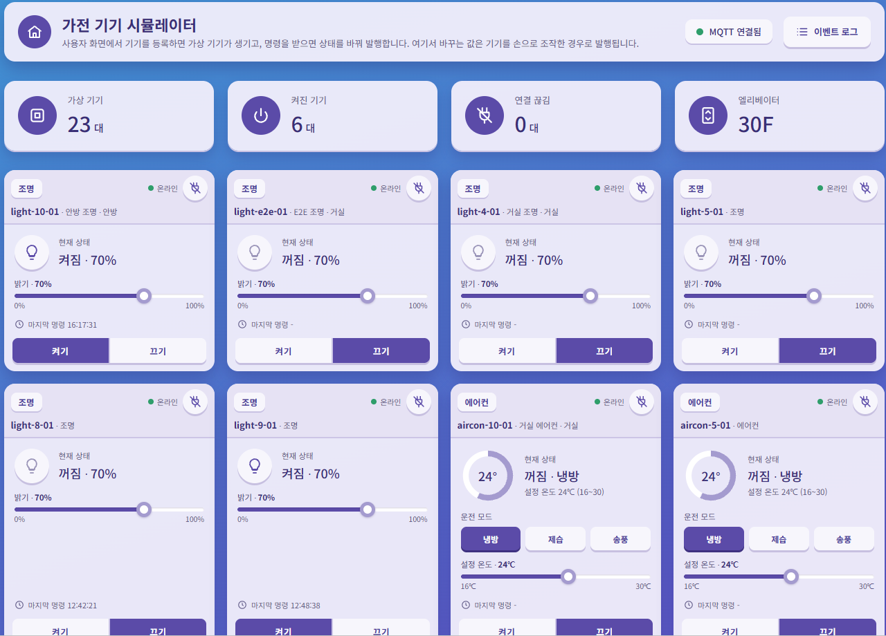
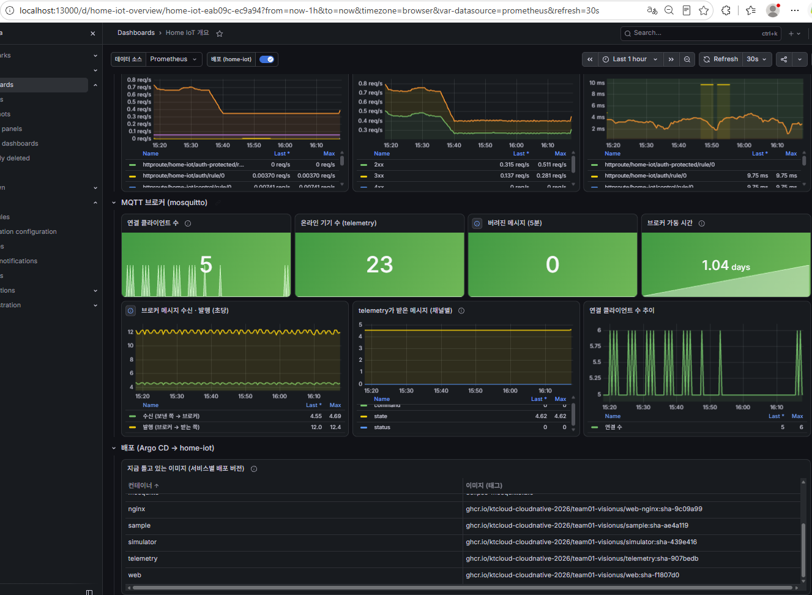
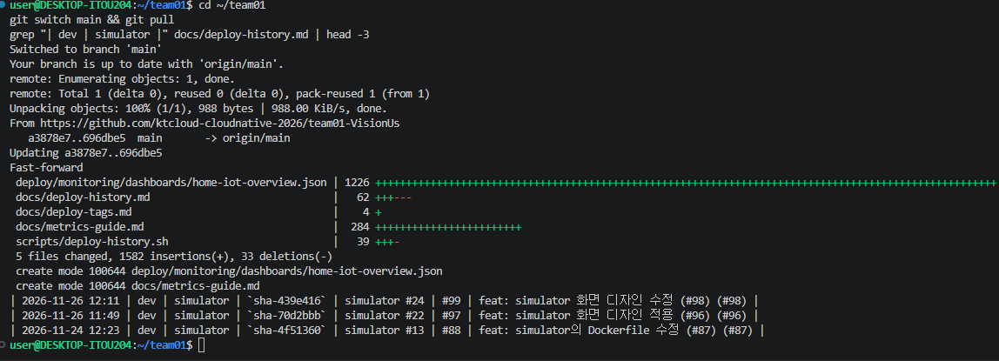
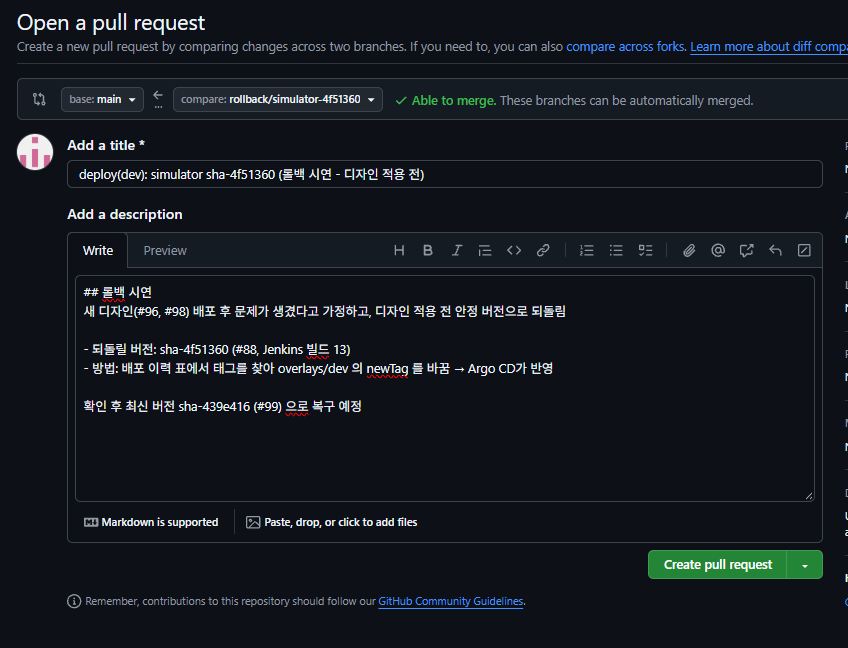
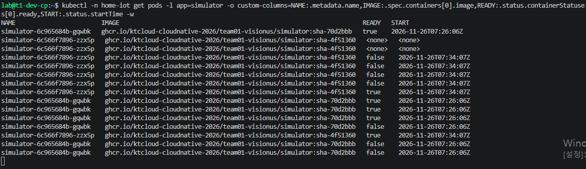
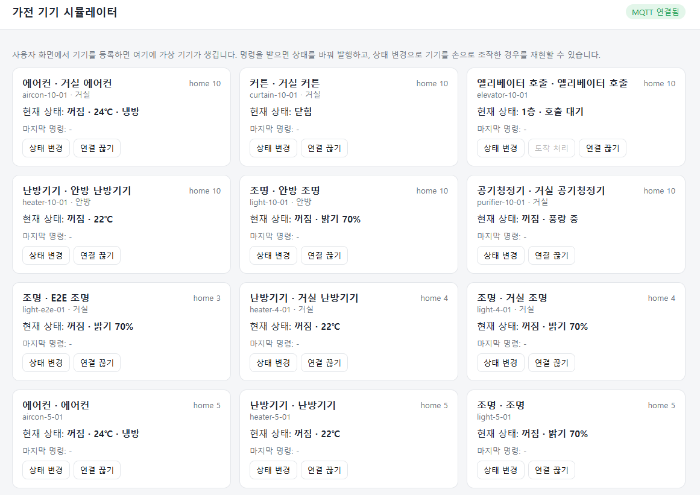
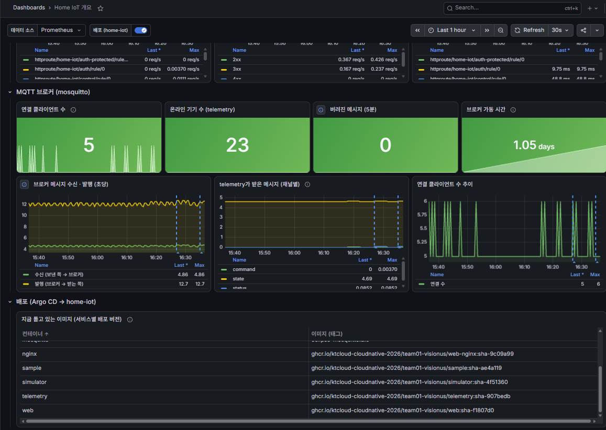
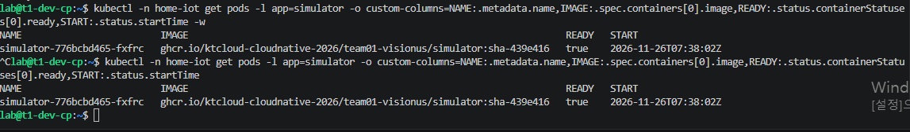
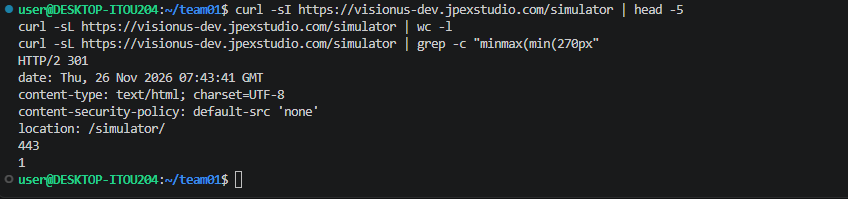

# 롤백 시연 기록

[← README](../README.md) · [태그 규칙 · 배포 이력](deploy-tags.md) · [런북](runbook.md) · [지표 가이드](metrics-guide.md)

2026-11-26, dev 클러스터에서 simulator를 이전 버전으로 되돌렸다가 최신 버전으로 복구했습니다. 절차는 [태그 규칙 5절 되돌리기](deploy-tags.md#5-되돌리기)를 그대로 따랐습니다.

## 1. 한눈에

| PR | 한 일 | 이미지 태그 | 머지 | 새 파드 시작 | 걸린 시간 |
|---|---|---|---|---|---|
| #105 | 직전 버전으로 롤백 | `sha-439e416` → `sha-70d2bbb` | 16:24:55 | 16:26:06 | 약 71초 |
| #106 | 디자인 적용 전 버전으로 롤백 | `sha-70d2bbb` → `sha-4f51360` | 16:33:20 | 16:34:07 | 약 47초 |
| #107 | 최신 버전으로 복구 | `sha-4f51360` → `sha-439e416` | 16:37:53 | 16:38:02 | 약 9초 |

- #105 · #106에서 **새 파드가 준비(Ready)된 뒤 이전 파드가 내려가는 것**을 확인했습니다. 서비스가 끊기지 않습니다 (롤링 업데이트)
- 롤백하는 동안 온라인 기기 수(23대)와 버려진 메시지(0)가 그대로였습니다. MQTT 연결 수는 시뮬레이터 파드가 바뀌는 순간 잠깐 5 ↔ 6 사이로 움직였다가 돌아왔습니다

## 2. 순서

### ① 롤백 전 상태 확인

시뮬레이터는 최신 디자인(`sha-439e416`, #99)입니다.



Grafana `Home IoT 개요` 맨 아래 표에서 지금 돌고 있는 버전을 봅니다.



### ② 돌아갈 태그 찾기

[배포 이력](deploy-history.md)에서 같은 환경 · 서비스의 이전 줄이 이전 버전입니다. 빌드 번호로 어떤 Jenkins 빌드가 만든 이미지인지도 알 수 있습니다.

```bash
git switch main && git pull
grep "| dev | simulator |" docs/deploy-history.md | head -3
```



### ③ 되돌리는 PR

`deploy/overlays/dev/kustomization.yaml` 의 `newTag` 한 줄만 바꿉니다. PR 제목을 `deploy(dev): <서비스> <태그>` 로 쓰면 배포 이력 표에도 롤백 기록이 남습니다.

```bash
git switch -c rollback/simulator-4f51360
sed -i 's/newTag: sha-70d2bbb/newTag: sha-4f51360/' deploy/overlays/dev/kustomization.yaml
git diff        # 한 줄만 바뀌었는지 확인
git add deploy/overlays/dev/kustomization.yaml
git commit -m "deploy(dev): simulator sha-4f51360 (롤백 시연 - 디자인 적용 전)"
git push -u origin rollback/simulator-4f51360
```



### ④ Argo CD 반영 확인

머지하면 Argo CD(`home-iot-dev`)가 Git을 보고 파드를 바꿉니다.

```bash
kubectl -n home-iot get pods -l app=simulator \
  -o custom-columns=NAME:.metadata.name,IMAGE:.spec.containers[0].image,READY:.status.containerStatuses[0].ready,START:.status.startTime -w
```



화면이 디자인 적용 전으로 돌아갔습니다.



대시보드 표가 `sha-4f51360` 으로 바뀌고, 모든 그래프에 **배포 시각 세로선**(16:26, 16:34)이 생겼습니다.



### ⑤ 최신 버전으로 복구

같은 방법으로 `newTag` 를 `sha-439e416` 으로 되돌리는 PR(#107)을 머지했습니다.



`/simulator` 는 `/simulator/` 로 리다이렉트(301)되므로 `-L` 을 붙여 확인합니다. 최신 버전에만 있는 CSS(`minmax(min(270px`)가 보이면 복구된 것입니다.

```bash
curl -sL https://visionus-dev.jpexstudio.com/simulator | wc -l                       # 443
curl -sL https://visionus-dev.jpexstudio.com/simulator | grep -c "minmax(min(270px"   # 1
```



## 3. 해보면서 알게 된 것

| 겪은 일 | 이유 | 대응 |
|---|---|---|
| 반영까지 9초 ~ 71초로 들쑥날쑥 | Argo CD는 Git을 약 3분마다 확인함. 머지 시점이 확인 주기 어디쯤이냐에 따라 달라짐 (최대 3분대) | 급하면 `kubectl -n argocd annotate application home-iot-dev argocd.argoproj.io/refresh=normal --overwrite` 로 바로 확인시킴. 개선: GitHub webhook으로 머지 즉시 알림 |
| 롤백했는데 브라우저 화면이 그대로 | 브라우저가 예전 페이지를 들고 있음 | 주소창에서 다시 엔터 또는 시크릿 창. 서버가 주는 화면은 curl로 확인 |
| `curl .../simulator` 결과가 10줄 | `/simulator` → `/simulator/` 301 리다이렉트 응답만 받은 것 | `curl -L` 로 따라가서 확인 |
| 직전 버전(#97)으로 롤백했는데 화면 차이가 거의 없음 | #98은 카드 크기 축소 · 이벤트 로그 화면 정리 같은 작은 수정 | 시연은 화면 차이가 큰 디자인 적용 전 버전(#88)으로 진행 |
| 롤백 후 시뮬레이터의 켜진 기기 · 엘리베이터 층이 처음 상태로 | 시뮬레이터가 기기 상태를 메모리에만 가짐 → 새 파드는 처음부터 시작 | 가상 기기라 문제 없음. 실제 기기 상태는 DB(`device_states`)에 있음 |

## 4. prod에서 할 때

- `deploy/overlays/prod/kustomization.yaml` 의 `newTag` 를 바꾸는 `deploy(prod)` PR을 만들고, **머지 = 승인** 입니다
- 이전 버전은 [배포 이력](deploy-history.md)의 prod 줄에서 찾습니다
- 확인은 prod Grafana(`localhost:13001`)의 같은 표 · 세로선으로 합니다
